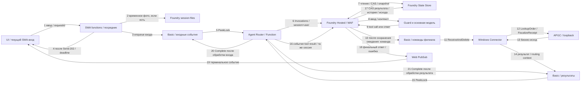

# Архитектура агентского расширения

Самодостаточный контракт системы. Он определяет целевое поведение, а не подтверждённость реализации.

## Парадигма и единицы выпуска

| Компонент | Ответственность |
|---|---|
| frontend + functions (SWA) | UI, существующая авторизация, negotiation/upload, приём и enqueue до 202 |
| agent-worker (Hosted) | Guard/main/MAF/tools, control/history, команда и конечный ответ |
| agent-router (Function App) | Проверка source/route, delegated Invocations, manual settlement input/results |
| connector (Windows) | Последовательный приём команд филиала, loopback API 1С, результат |

Инфраструктурный Storage Router не является прикладной БД. Hosted sandbox не содержит постоянного consumer общей очереди.

## Принятые инварианты

### AD-1 — Компоненты и владение кодом [ADOPTED]

Четыре независимых выпуска: SWA, Worker, Router, Connector. Нет ссылок между исполняемыми проектами и общей платформы с другими интеграциями.

### AD-2 — Модельный guard и контролируемые инструменты [ADOPTED]

Мультимодальный guard проверяет текст/фото до main agent. Допуск отделён от извлечения. Runtime проверяет tools/аргументы; фискализация требует явной просьбы администратора, без дополнительной кнопки.

### AD-3 — Прикладная память в Foundry [ADOPTED]

История MAF и control только в Foundry State Store. Один активный turn/session. Успешный контекст переживает idle/restart; ошибка закрывает сессию.

### AD-4 — Приём через очередь и ответ через Web PubSub [ADOPTED]

UI подключает Web PubSub до Send. SWA возвращает 202 после подтверждённого enqueue; итог/ошибка доставляются отдельно. HTTP intake/upload/202 ≤45 секунд.

### AD-5 — Basic, два режима приёма и корреляция [ADOPTED]

Service Bus Basic: input, results, commands каждого филиала. Router — PeekLock, Connector — ReceiveAndDelete. Тип события задаёт доверенная исходная очередь.

### AD-6 — Отказ, deadline и отсутствие бизнес-replay [ADOPTED]

Нет outbox, ServiceOperations, startup/timer recovery, бизнес-replay или HTTP recovery ответа. Redelivery не повторяет захваченный этап. UI timeout не отзывает команду до expiresAt.

### AD-7 — 1С владеет бизнес-результатом и безопасностью повторов [ADOPTED]

1С — источник бизнес-истины. Повторы, параллельные/перекрывающиеся и неоднозначные вызовы не должны повторно фискализировать чек; гарантия проверяется до выпуска. Нет commandId registry или execution journal Connector.

### AD-8 — Заказ и фото-подсказки [ADOPTED]

Заказ определяется branchId + orderNumber с ведущими нулями; сумма только дополнительная проверка. Видимый сервисный код содержит филиал/номер, второй QR не добавляется.

### AD-9 — Единый вход и проверенный маршрут [ADOPTED]

Единственный вход — личные Microsoft-аккаунты через SWA. Доверенный server principal, делегация и проверка owner/session обязательны. Endpoint не выбирается браузером или payload.

### AD-10 — Локальная граница Connector [ADOPTED]

Windows-служба обслуживает одну базу/филиал через loopback рядом с Apache. Команды последовательны; собственная API-сессия не является recovery бизнес-операции.

### AD-11 — Данные и определения агентов [ADOPTED]

Фото временно в Foundry files, main получает разрешённые поля. Тексты/ответы/фото не копируются в нашу БД/логи. Definitions в Backend-коде; managed definitions — согласованное исключение. Azure-first, без заранее созданной provider abstraction/визуальных Workflows.

### AD-12 — Application Insights без отдельного аудита [ADOPTED]

Application Insights — whitelist структурированных фактов/метрик, без отдельного аудита и обязательной записи перед эффектом. Содержимое и секреты не захватываются.

### AD-13 — Агентная и сквозная проверка до выпуска [ADOPTED]

Агентные оценки guard/photo/context/tools/truth/adversarial/regressions обязательны отдельно от API-тестов. Пороги/повторы согласуются до приёмки, действия проверяются детерминированно плюс экспертно.

### AD-14 — Независимый выпуск и предел поручения [ADOPTED]

SWA/Hosted/Router выпускаются независимо из develop; Connector — артефакт с ручной установкой. Изменение одного компонента не запускает лишний SWA deploy. Свой Bicep — agent-extension/infra, без импорта корневого infra.

### AD-15 — Hosted runtime и принятый риск зрелости [ADOPTED]

Worker — наш .NET/MAF в Foundry Hosted Agents, ZIP bundled dotnet_10 без своего registry. Preview State Store/prerelease SDK — принятый риск; квоты/стоимость/совместимость проверяются отдельно.

### AD-16 — Один атомарный переход до эффектов [ADOPTED]

Create-only и конкретный ETag/CAS предшествуют model/tool effects. Control и текущая snapshotRef меняются одним item. Полное waiting до Send; после Send старый handler не пишет state/history. Второй auto-writer MAF запрещён.

### AD-17 — Очистка Foundry и пределы хранения [ADOPTED]

Control/receipt удерживаются до конца допуска всех событий + skew, даже после закрытия. Отсутствующее состояние не воссоздаётся result/start. Deadline, TTL и удаление files независимы; LLM не cleaner.

## Весь цикл

Сначала сервер готовит новую Foundry session: create-only каталог очистки, затем control IdleEmpty. Частичный/неоднозначный prepare запрещает UI-ready, upload/start; старую сессию не переоткрывает. Стрелки задают зависимости, не глобальный FIFO: result может прийти раньше возврата Send-handler.

## Состояние и переходы

| Store / isolation | Данные | TTL |
|---|---|---|
| agent-control-v1 / true | Owner/branch/phase/operation-stage-tool-command IDs/deadline/protectUntil/current snapshotRef/lastSuccessfulAt/historyDeleteAt | 7 дней |
| agent-receipts-v1 / true | Immutable admission IDs/digest/owner/session/branch/expiry/protectUntil, create-only | 7 дней |
| agent-success-v1 / true | Immutable успешный MAF snapshot | 259200 секунд |
| agent-pending-v1 / true | Снимок этапа и полного ожидания | 300 секунд; без recovery |
| agent-maintenance-v1 / false | OwnerKey/session/branch/registeredAt/schemaVersion/agent-version, без content/credentials/callId | Без expiry до безопасного удаления |

Foundry ограничивает ключ item 128 символами. Составные ключи receipts и snapshots сохраняют прежний вид `session + суффикс`, если укладываются в лимит. Для более длинного ключа используется `sha256-` и SHA-256 полного составного ключа в UTF-8, в нижнем hex. Старые допустимые ключи receipts доступны по прежним адресам. Сохранённая `snapshotRef` остаётся непрозрачным ключом для чтения.

Snapshot: schemaVersion=1, mafVersion=1.26.0, agentDefinitionVersion, serializedSession; ≤900 KiB UTF-8 при service item ≤1 MB. Сначала immutable snapshot, затем control+ref одним CAS. Проигравший оставляет сироту без эффекта. Отсутствующий/несовместимый/слишком большой снимок закрывает turn, без молчаливой потери истории.

| Переход | Барьер перед эффектом |
|---|---|
| IdleEmpty/IdleSuccess → InputClaimed | Проверить start, создать admission marker, затем CAS существующего control; только создатель marker. Дубль marker не продолжает работу даже после crash до CAS. Конкурентный start не меняет active turn и не стартует позже |
| InputClaimed → ModelClaimed | Новый stage/snapshotRef до одного model call; auto tool execution выключен |
| ModelClaimed → WaitingTool | Access/args/explicit fiscal request/expiry, полный snapshot+IDs/route/hash/branch/deadline; затем одна попытка Send |
| WaitingTool → ResultClaimed | Точный ожидаемый owner/session/operation/tool/command/route/hash/outcome/expiry; CAS до continuation |
| Успех → IdleSuccess | Success snapshot+lastSuccessfulAt/historyDeleteAt; затем одна PubSub попытка |
| Отказ → ClosedFailed | Нет следующих tools/turn в этой session |

Технический этап без моделей может перейти InputClaimed → WaitingTool. Дубли, late/closed/missing не создают stage/effect. Смена branch или истечение успешной истории требует новой prepared session. Новый запрос имеет новые IDs.

Set/Delete используют конкретный непрозрачный ifMatch. requireExists=true означает If-Match:*; его нельзя сочетать с конкретным ifMatch, existence alone не CAS. Strict update не создаёт missing item. Store create фиксирует TTL/isolation; несовпадение требует совместимого решения/нового имени. Write продлевает TTL, read нет.

## Отказы, сроки и транспорт

Crash после marker/claim допускает потерю исполнения, не повтор модели, Send или continuation. Неоднозначный claim/Send fail-closed; read/CAS retry не разрешает повтор внешнего эффекта. Быстрый result не затирается post-Send writer. Нет транзакции State Store+SB+1С/exactly-once. Потеря финала даёт UI timeout; reconnect не восстанавливает старый ответ.

| Ограничение | Правило |
|---|---|
| Общий бюджет | UI: монотонные 120 секунд от Send вместе с upload; 202 таймер не сбрасывает, после 10 секунд виден остаток |
| Deadline | min(clientSentAt+120s,serverReceivedAt+120s); истёкшее отклоняется до upload/enqueue, все этапы наследуют expiry |
| Browser clock | UTC clientSentAt принят без admission lease; неверные часы могут дать ранний expiry или server expiry позже реального Send+120s. Server cap не attestation времени клика |
| Intake | ≤45 секунд и остатка deadline; неукладывающееся фото исключается, номер можно отправить явно без auto resend |
| API/финал | API budget=min(30s,remaining−15s), включая подготовку session; неположительный остаток запрещает вызов. До Send резерв 15s |
| Skew/protectUntil | 5s только future issuedAt/retention; protectUntil=max(expiresAt событий)+5s, не разрешает действие после expiry |
| SB | TTL — положительный остаток ≤120s; lock60s, auto-renew120s, MaxDeliveryCount3,prefetch0; без Sessions/topics |
| Повторы | Прикладные model/API/Send=0; встроенные SDK retries ограничить/проверить; bounded redelivery/DLQ не business recovery |

Router Complete только после полного HTTP200 application/json ACK {schemaVersion:1,eventId,disposition:Processed|Duplicate|Discarded} исходного eventId. Processed завершает этап, не доказывает успех 1С. Detached202/SSE/неполный или чужой ACK не разрешают Complete. Локальный lock Router не сериализует instances.

## Обмен и бизнес-исходы

JSON UTF-8 v1, UTC RFC3339 Z; повторяющиеся свойства/неверные типы/неизвестные обязательные версии отклоняются. Envelope ≤64 KiB, start text ≤8 KiB; binary фото в очередях нет.

Envelope: schemaVersion/kind/eventId/requestId/operationId/branchId/issuedAt/expiresAt/route/dataB64; command/result добавляют commandId/toolCallId/commandType. Request/event/operation/command — UUID D без reuse; opaque IDs ≤128 ASCII, ordinal. Sandbox ID, MAF session ID и platform call ID различны. Branch — 1–128 цифр; orderNumber — до64 с ведущими нулями. Amount decimal-string+currency — hint, не identity.

dataB64 — base64url без padding точных JSON bytes; data одновременно запрещено. Start dataHash и commandDataHash — SHA256 decoded bytes без reserialize/canonicalizer. Result имеет новый eventId/issuedAt, но сохраняет command/tool/correlation/expiry/route; command eventId=commandId.

UI POST /api/backoffice/agent/negotiate получает sessionHandle/connectUrl после prepare. POST /api/backoffice/agent/turns принимает requestId/sessionHandle/branchId/text/clientSentAt и контролируемое фото. 202 возвращает requestId/operationId/deadline после Send; AcceptanceUnknown не вызывает auto retry. Active-turn conflict решает Hosted CAS; синхронный409 без authoritative check не обещается. Итог turn.final: requestId/operationId/status Answered|Failed/answer?|errorCode? только своей server group, не raw tool output.

LookupOrder: Found+order, NotFound без order, Failed+reasonCode. Order содержит number/state/receiptState/amount и известный receiptNumber. FiscalizeReceipt: Fiscalized/AlreadyFiscalized с подтверждённым номером либо Rejected/RequiresVerification/TechnicalFailure. Unknown receipt state и amount mismatch не разрешают действие. NotFound — успешное отсутствие; AlreadyFiscalized — факт без второго действия; отказы закрывают session. HTTP200, SB acceptance и подпись route не являются бизнес-успехом; неизвестный outcome — protocol failure, неизвестный reason не permission.

## Доверие, делегация и права

SWA principal проверяется платформой; server userKey/delegation — namespaced SHA256(identityProvider+stable userId), не email/displayName/body/header браузера. Все допущенные пользователи равноправны для configured branches/actions, но чужие sessions/history/channels недоступны; новой personal-grants системы нет.

| Identity | Разрешённый scope |
|---|---|
| Browser | SWA session, connect token своего Web PubSub канала ≤5 минут; без SB/Foundry/private keys/client send или join wildcard |
| SWA | Sender input; negotiation WPS; delegated session create/upload |
| Router | Receiver input/results; fixed Hosted invoke+UserIdentityImpersonation; без commands Send |
| Hosted | User-context State Store/files; Sender configured commands; publisher owner/session group |
| Connector | Entity SAS Listen own commands+Send results, loopback credential; без namespace Manage/Foundry |
| Maintenance | Только необходимые cross-user session/files/state и protected invocation выбранного project/agent; без model/commands/new turns |

MI используется где поддержана; MI managed SWA API не предполагается. Runtime не получает deploy/manage права оператора; resource-scoped data actions, без wildcard Owner/Contributor. WPS negotiation: clientConnection/generateToken/action+clientConnection/write; publisher — нужный group send, scope самого WPS.

Invocations: fixed endpoint, query agent_session_id, доверенный server x-ms-user-identity и свежий opaque platform call ID на Store call. Call ID не хранится/не передаётся Connector. Делегированный user сам по себе не доказывает source tool.result: проверяются source queue, bytes/route и ожидаемое state.

Гибрид доверия: вызвать Worker может только managed identity Router с `Foundry Agent Consumer` и отдельной ролью с data action `Microsoft.CognitiveServices/accounts/AIServices/agents/endpoints/UserIdentityImpersonation/action` на scope конкретного агента. [Разрешения Hosted Agent](https://learn.microsoft.com/en-us/azure/foundry/agents/concepts/hosted-agent-permissions#delegate-the-end-user-identity). Input Sender — SWA; results Sender — Connector; их читает Router. Это требование доступа, не доказанный live RBAC. Делегированный owner не заменяет проверку источника.

SWA подписывает Prepare/Start; Router отдельным private key подписывает Result только после source admission results queue. Worker хранит только public keys обоих issuer и проверяет bytes результата, correlation/route/command hash/expiry против полного WaitingTool. Connector не имеет signing keys и возвращает route/commandDataHash неизменёнными. Command route сохраняет исходный SWA JWS, а не подпись Worker; команды защищены queue-scoped Sender и validation Connector. Точные версии/claims — [D2](../../../specs/spec-agent-extension/message-contracts.md).

Verify PS256/RSA≥2048 точных ASCII base64url(header).base64url(claims), без duplicate keys/jku/x5u/network key lookup. Private keys SWA/Router — разные, в protected settings; нет private keys в Worker/source/ZIP/Store/model. Ротация: public kid доставляется раньше switch signer, old verify key держится до max expiry+skew; compromised key revoke даёт ошибку, не replay. RBAC и source admission обязательны даже при правильной подписи.

Остаточные риски: возможность прямого обходного доступа к контейнеру не доказана; широкие административные роли позволяют менять RBAC; при проверке учитывать унаследованные назначения; Router — единая точка доверия к сопоставлению queue→тип и делегированному owner. Hosted Start/Result остаются закрыты до отдельного допуска и негативных RBAC-проверок.

## Connector и данные

Generic Host/Options/startup validation; public appsettings.json и локальный Development overlay под ACL (вне Git/publish, Debug copy допустим). Настройки применяются перезапуском, установка/обновление ручные. Basic на каждый loopback API request; GET PingPath с IBSession:start → cookie ibsession, finish закрывает; перед POST LookupPath ping/recreate, без повтора текущего business request. API JSON contractVersion1/outcome/reasonCode/order?, ≤16 KiB; Content-Type может отсутствовать, JSON всё равно строго проверяется.

Telegram внутри службы: status/check/stop/start/reset API и stop/start/recreate listener; chat+sender allowlist, freshness/replay checks, serial gate с lookup. Busy не отложенная команда; reset API не включает manual-stopped listener. Нет SCM/shell/process restart или management recovery из файлов. Локальный Serilog daily log, последние10файлов, не execution journal.

## Очистка

История доступна 3 дня от последнего успеха без read/maintenance renew. После guard/распознавания фото удаляется немедленно. Upload только prepared session, immutable uploads/{serverIssuedTimestamp}-{uuid}, timestamp до записи без продления partial/read. Ошибка upload/enqueue/delete оставляет обнаруживаемую сироту; sandbox stop/Store TTL не удаляют files автоматически, HOME/SDK temp проверяется отдельно.

Отдельный Logic App каждые72 часа UTC, emergency photo/orphan ≤6 дней от upload; не timer Router/новая прикладная БД/пятая application release.

| Шаг | Ограничение |
|---|---|
| 1 scan | Fixed maintenance.scan от allowlisted non-delegated Logic App identity; user/admin route недостаточен |
| 2 permit | Paging catalogue batch≤20; Backend-signed exact owner/session/branch/audience maintenance-clean/delete allowlist/expiry≤10 минут; без active-turn mutation |
| 3 clean | Delegated maintenance.clean с query session и server identity; signature/audience/expiry/current identity/catalogue сверены, свежий call ID |
| 4 state | Specific-ETag delete по phase/expiry/protectUntil; active snapshot не удаляется по возрасту, missing control не recreate |
| 5 files/session | Upload age≥3 дней удалить, следующий штатный обход удерживает6дней. Session целиком только после confirmed closed/expiry/control CAS |
| 6 errors | 404 success; ETag conflict reread/skip, не force; listing/delete≤3 maintenance attempts/run. Missed run/outage за6дней — нарушение, не PASS |
| 7 catalogue | Specific ETag после missing/safely closed control, protectUntil и отсутствия files/live session; resume paging не business replay |

Если originating service недоказуем, нужен separately verified service-signed maintenance envelope до cross-user допуска. Private key не у Logic App/browser, paths/agent фиксированы. Secure inputs/outputs и run/error history без owner/routes/content/secrets.

## Поставка и версии

Worker: framework-dependent linux-x64, плоский ZIP≤250 MB multipart, entry dotnet Worker.dll, code_configuration/runtime dotnet_10/dependency_resolution bundled. SHA256 связывает ZIP с agent/version; invoke проверяет active version. Без container_configuration/ACR. Managed patch контролирует платформа; проверить ASP.NET shared framework/native Linux dependencies/restore/MAF hydration, не только target framework. Локальный Store fallback не cloud proof.

SDK10.0.403/net10.0/local runtime10.0.14; Core1.0.0-beta.29; Invocations1.0.0-beta.7; Microsoft.Agents.AI1.26.0; Projects.Agents3.0.0-beta.3; Identity1.21.0; ServiceBus7.21.0; WebPubSub1.7.0. Router: Azure.Functions.Sdk1.0.0, Worker2.52.0, ServiceBus extension5.24.0. Data-plane v1, Invocations2.0.0, scope https://ai.azure.com/.default.

Ресурсы/endpoints/region/quotas, trusted identities/keys, models/prompts/thresholds и step-token-vision limits — явная конфигурация, согласуемая до соответствующей приёмки. Нет обещания all-in цены/бесплатности; учитываются Hosted до idle, Store/files, SB/polling, Router/Storage, WPS, models, Logic App, telemetry. Caps/instances не денежный потолок.

## Обязательная агентная и сквозная проверка

Версионированные неперсональные сценарии и реальные выбранные модели: guard false admit/deny, фото/неопределённость, successful context, tool args/order/correlation/results, truth, injection/adversarial, лимиты и регрессии. Детерминированные запреты плюс экспертный просмотр; judge не единственное основание, дословный ответ/единственная траектория/скрытые рассуждения не требуются.

Отдельно: два пользователя/филиала, начало после202, fast/late/duplicate results, несколько instances, crash до/послеSend, lost ACK/уведомление, idle/hydration, stale/missing snapshots, TTL/delete↔writer, полный cleanup paging/partial upload/пропущенный запуск, подписи/negative RBAC,45/120 секунд и гарантия реальной1С. До реальных фискальных действий безопасный профиль испытаний с недоступным реальным провайдером определяется и согласуется; автоматической замены этого gate реальной фискализацией нет.

Telemetry whitelist: обезличенная correlation/versions/stage/outcome/reasonCode/duration/call-token counters. Запрещены реальные тексты/ответы/фото, user identity, payload/dataB64/route/SAS/tokens/Authorization/connect URLs/local sessions. Отключить content/error auto-capture и дубли MAF/client spans; подробные трассы только prepared data. Потеря логов не повторяет действие.
